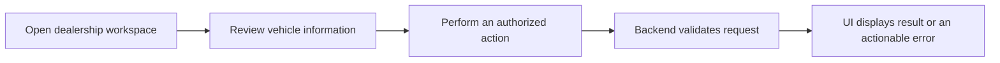

# Car Desk
### Engineering case study · Automotive SaaS

**A product-oriented look at building and validating software for automotive dealerships.**

**Focus:** SaaS architecture · Backend workflows · Product UI/UX · Automated testing  
**Project type:** Commercial software / private source code  
**Showcase purpose:** Demonstrate engineering work without distributing the product implementation

---

## 01 / The product

Car Desk is a SaaS project focused on software workflows for automotive dealerships. The product domain brings together dealership operations and the digital experience around vehicle inventory and presentation.

The engineering challenge is to connect an approachable interface with dependable backend behavior, clear data flows, and repeatable quality checks.

> This is a **public engineering case study**, not a downloadable version of the product. The original codebase remains private.

## 02 / Product experience

The following illustrates the **user journeys and design considerations** behind a dealership SaaS. It is a high-level UX view, **not a claim that every screen or feature shown below is live**.

| Experience area | UX goal | Engineering consideration |
| :--- | :--- | :--- |
| **Dealership workspace** | Help staff understand their operational context quickly | Clear states, predictable data loading |
| **Vehicle information** | Make vehicle records understandable and easy to work with | Validation and data consistency |
| **Customer-facing presentation** | Make vehicle details easy to discover and evaluate | Separation of presentation and business logic |
| **Feedback & errors** | Keep users informed when something fails or takes time | Error handling and consistent API responses |

### Illustrative user journey

*The diagram is a conceptual UX walkthrough, not a screenshot or a verified production flow.*

## 03 / Engineering approach

My work on Car Desk has involved SaaS development, backend-oriented workflows, application architecture, and automated validation.

Key engineering themes:

- **Separation of responsibilities:** Keep interface concerns distinct from backend and data concerns.
- **Reliable behavior:** Consider invalid inputs, error paths, and state changes, not only the happy path.
- **Maintainability:** Treat product development as an evolving system rather than a one-off demo.
- **Verification:** Use automated tests to reduce regressions during development.

### Quality snapshot

In a **historical internal validation run** of Car Desk, the test suite reported:

| Test area | Passing tests |
| :--- | ---: |
| Backend | **490** |
| Frontend | **240** |

*These counts describe a past validation snapshot, not a live CI badge, current coverage percentage, or a guarantee that every test still passes today. The underlying private test suite is not distributed in this repository.*

## 04 / UI & architecture materials

This showcase will be expanded with carefully reviewed materials:

- [ ] Sanitized screenshots from the actual application, with permission to publish
- [ ] A product walkthrough showing the user experience
- [ ] A simplified, verified architecture diagram
- [ ] Selected engineering decisions and trade-offs that can be shared publicly

**No mockup is presented as an authentic product screenshot.** Until reviewed visual assets are available, this README focuses on the verified project context and a clearly labeled conceptual flow.

## 05 / What this project demonstrates

- Experience working on a **real product domain** rather than an isolated coding exercise
- A focus on **backend reasoning and application quality**
- Awareness of **product UX, maintainability, and testing**
- The ability to communicate engineering work while respecting **commercial confidentiality**

---

## Source code & confidentiality

The commercial repository is **private**. This public repository intentionally excludes:

- Proprietary source code or internal business rules
- Credentials, tokens, environment configuration, or production endpoints
- Client data or confidential documents
- Unreviewed internal screenshots and diagrams

There is **no runnable application or reusable implementation** in this repository. Its contents are descriptive case-study material, not a software release.

## Connect

**Paulino Núñez** · Software Developer — Backend, APIs & AI Automation  
[GitHub profile](https://github.com/Paulgg-cmd) · [LinkedIn](https://www.linkedin.com/in/paulinonunez/)
